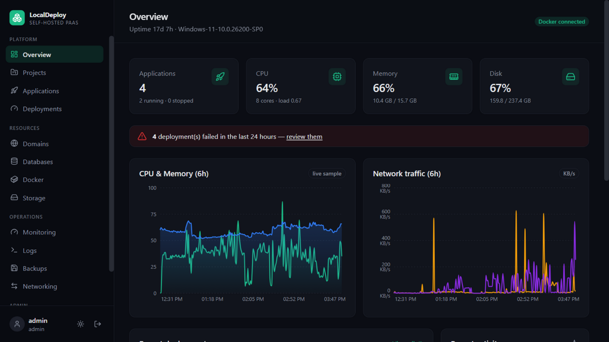
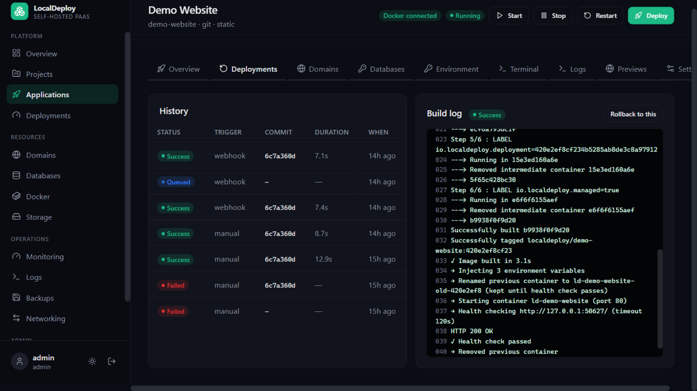
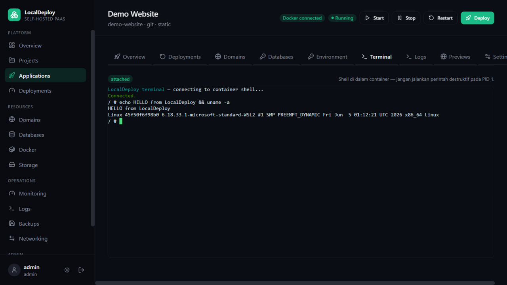
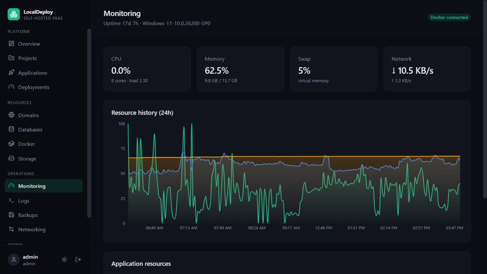
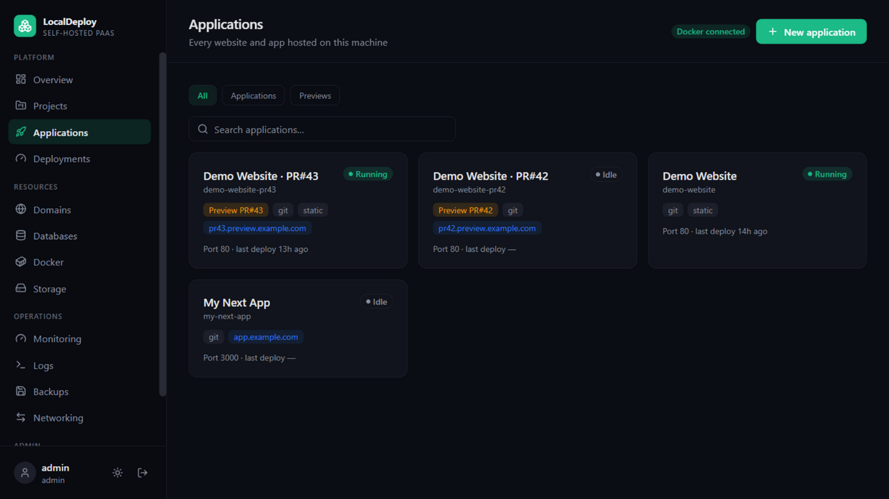
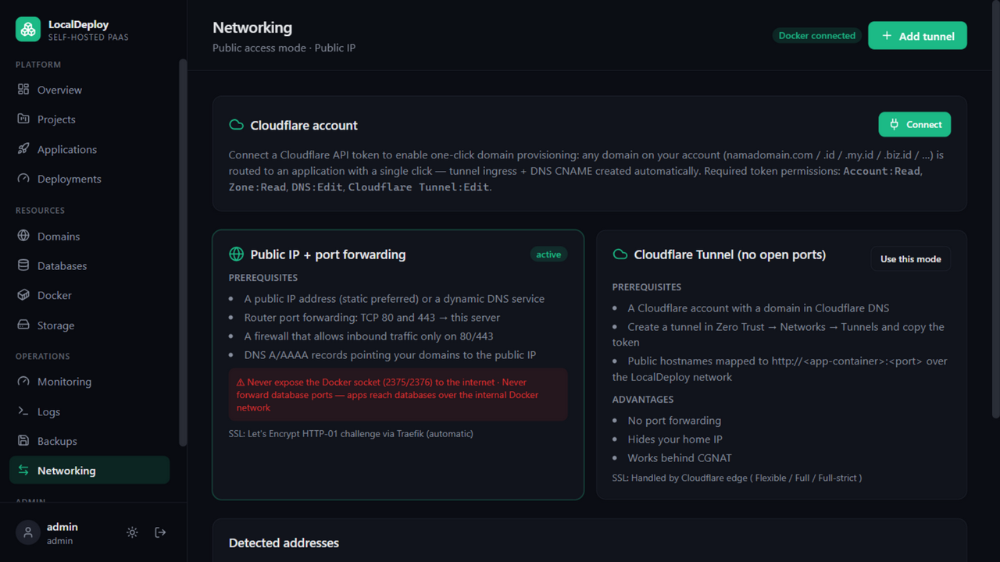

<div align="center">

# 🚀 LocalDeploy

**Turn any PC into a self-hosted cloud platform — your own PaaS, at zero infrastructure cost.**

Deploy from Git with automatic runtime detection, route domains with one-click SSL,
provision databases, monitor everything — inspired by Dokploy, Coolify & CapRover.

[](https://github.com/eka0789/localdeploy/actions/workflows/ci.yml)
[](#testing)
[](LICENSE)


</div>

---

## ✨ What is LocalDeploy?

LocalDeploy transforms an idle PC, laptop, or mini-PC into a **full application hosting platform** —
a practical, cost-efficient alternative to renting VPS instances (a small idle PC draws 10–25 W,
roughly 60–80% cheaper than a comparable VPS).

- 🚀 **Deploy anything** — Git repos with auto-detected runtimes (Next.js, Node, React/Vue/Angular,
  NestJS, Laravel/PHP, FastAPI/Django/Flask, Go, Java/Spring, Ruby, static), custom Dockerfiles,
  Docker Compose, prebuilt images, or uploaded archives
- 🌐 **Any domain, one click** — Cloudflare API integration provisions tunnel ingress + DNS CNAME
  automatically (`namadomain.com`, `.id`, `.my.id`, `.biz.id`…), SSL handled at the edge
- 🗄️ **Databases** — managed containers (PostgreSQL/MySQL/MariaDB/Redis/MongoDB) **plus** external
  providers (Supabase, Neon, Turso, Atlas, Upstash, PlanetScale) with encrypted credentials and
  automatic env-var injection
- 🔁 **Zero-downtime deploys** — immutable image tags, health-checked switch, one-click rollback
- 🔀 **Preview deployments** — every pull request gets an isolated environment + its own URL
- 📈 **Auto-scaling** — CPU-based replica scaling with hysteresis, Traefik load balancing
- 🖥️ **Multi-server** — outbound agent architecture: manage remote Docker hosts with zero inbound ports
- 📊 **Observability** — real-time build/container logs over WebSocket, interactive container
  terminal, server & per-app metrics, Prometheus endpoint
- 🔔 **Notifications** — Discord / Telegram / Slack / generic webhooks on deploy & container death
- 💾 **Scheduled backups** — databases and volumes with retention policies
- 🔐 **Security-first** — Argon2id, server-side sessions, CSRF double-submit, rate limiting, RBAC,
  Fernet-encrypted secrets, audit log, API tokens for CI/CD

## 📸 Screenshots

| Overview | Deployments with live build log |
|---|---|
|  |  |

| Interactive container terminal | Auto-scaling & monitoring |
|---|---|
|  |  |

| Applications with preview badges | Cloudflare integration |
|---|---|
|  |  |

> More: [docs/screenshots/](docs/screenshots) — external databases, domains, backups.

## 🏗️ Architecture

```
                    ┌──────────────────────────────────────────────────┐
Internet ──► Cloudflare Edge (SSL) ──► Tunnel / port 80-443           │
                    │                 ▼                              │
                    │  ┌──────────────────────────────────────┐      │
                    │  │ Traefik (labels-based routing)       │      │
                    │  └──────────────┬───────────────────────┘      │
                    │                 ▼                              │
                    │  App containers · Compose projects             │
                    │  Managed DBs (private network only)            │
                    │  cloudflared                                   │
                    │  ─────────────────────────────────────         │
                    │  Dashboard (Next.js :3000) ──► API (FastAPI)   │
                    │                                 │              │
                    │        ┌────────────────────────┼─────────┐    │
                    │        ▼                        ▼         ▼    │
                    │  Deployment worker       Docker Engine   DB   │
                    │  (build→health→switch)   (WSL2/remote)         │
                    └──────────────────────────────────────────────────┘
                                        ▲
                              Remote hosts run agent.py (dial-out,
                              zero inbound ports) for multi-server
```

## 🚀 Quick Start

### Linux (production)

```bash
git clone https://github.com/eka0789/localdeploy.git && cd localdeploy
cp .env.example .env      # set SECRET_KEY, POSTGRES password, ACME_EMAIL
docker compose up -d --build
# or one-command: ./scripts/install.sh
```

### Windows / WSL2 (development)

See [docs/WSL2.md](docs/WSL2.md) — Docker Engine inside WSL2 + mirrored networking,
then `docker compose up -d --build`, or run the API and dashboard directly:

```bash
# API
cd apps/api && python -m venv .venv && .venv/bin/activate
pip install -e ".[dev]" && alembic upgrade head
uvicorn app.main:app --port 8000

# Dashboard
cd apps/dashboard && npm install && npm run dev
```

Login with the bootstrap admin from `.env` (default `admin` / `localdeploy123`) —
**change it immediately**.

### First deployment in 5 minutes

1. Overview → verify **Docker connected**
2. Applications → New application → Git repo → Deploy → watch the live build log
3. Domains → add `app.yourdomain.com` → **Tunnel** → provisioned
4. `https://app.yourdomain.com` is live 🎉

Full walkthrough (Bahasa Indonesia): **[docs/PANDUAN-LENGKAP.md](docs/PANDUAN-LENGKAP.md)**

## 🤖 CI/CD

| Workflow | Trigger | What it does |
|---|---|---|
| `ci.yml` | push / PR | Backend pytest suite + dashboard type-checked build |
| `deploy.yml` | manual (`workflow_dispatch`) | Redeploys an application through the LocalDeploy API using a `LOCALDEPLOY_TOKEN` secret |

Set these in **Repo → Settings → Secrets and variables → Actions** to enable `deploy.yml`:

| Secret | Value |
|---|---|
| `LOCALDEPLOY_TOKEN` | Personal access token (`ldt_…`) — Settings → API tokens |
| `LOCALDEPLOY_APP_ID` | Application ID from the dashboard URL |
| `LOCALDEPLOY_URL` | Public API base URL (e.g. `https://api.yourdomain.com`) |

## 🗺️ Feature Parity

| | LocalDeploy | Dokploy (free) | Coolify |
|---|---|---|---|
| Git/buildpack deploys, rollback | ✅ | ✅ | ✅ |
| One-click Cloudflare domain provisioning | ✅ | ✅ | ✅ |
| External DB integrations + env injection | ✅ | ✅ | ✅ |
| Preview deployments per PR | ✅ | ❌ | ✅ |
| Multi-server (outbound agent) | ✅ | ❌ | ✅ |
| Replica auto-scaling | ✅ | ✅ | ✅ |
| Container terminal, notifications, scheduled backups, API tokens | ✅ | ✅ | ✅ |

## 📚 Documentation

- **[Panduan Lengkap (ID)](docs/PANDUAN-LENGKAP.md)** — full user guide in Bahasa Indonesia
- **[Mitigasi Downtime (ID)](docs/MITIGASI-DOWNTIME.md)** — keeping services reachable when the
  PC is off or the internet drops (Cloudflare Worker fallback included)
- [Architecture](docs/ARCHITECTURE.md) · [Networking](docs/NETWORKING.md) ·
  [Environment](docs/ENVIRONMENT.md) · [WSL2 setup](docs/WSL2.md) ·
  [Troubleshooting](docs/TROUBLESHOOTING.md) · [Agent](apps/agent/README.md)

## 🧪 Testing

```bash
cd apps/api && pytest -q        # 65 tests: security, buildpacks, deploys, RBAC, integrations
cd apps/dashboard && npm run build   # type-checked production build
```

## 📄 License

[MIT](LICENSE) © [eka0789](https://github.com/eka0789)
